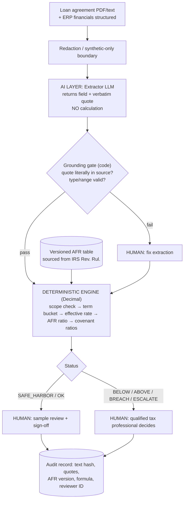

# Intercompany Loan Pricing & Covenant Checker
**Tresata Take-Home · Written Brief + Appendix** · Jurisdiction: **United States** (IRC §482, Treas. Reg. §1.482-2(a)) · Data: **public rules + 100% synthetic examples**

> **Terminology fix:** "§482" is the US Internal Revenue Code section. The OECD equivalent is the *Transfer Pricing Guidelines* (Chapter X, financial transactions). This brief implements the US rule and notes what changes for OECD countries.
> Figures marked *(assumption)* are my estimates, not sourced facts, so verify before quoting.

---

## 1. Written Brief

### 1.1 Area explored and what surprised me
I started with "transfer pricing" broadly and narrowed to **intercompany loans**. Three things surprised me:
1. Pricing a loan is not a judgment call at the first gate. The US offers a **safe-haven band: 100%–130% of the Applicable Federal Rate (AFR)**, a table lookup plus a division. The hard part is *reading the contract correctly*, not the arithmetic.
2. The comparison is only valid if **compounding and term bucket match** the AFR table. A 4.05% nominal quarterly-compounded loan is *above* a 4.10% annual AFR once converted (effective 4.1119%). A naive comparison gets it wrong.
3. The same contract also carries **financial covenants** (leverage, interest coverage) that someone re-tests every quarter from a different data source (the ERP).

### 1.2 Problem statement
| | |
|---|---|
| **Who** | In-house tax / treasury analyst at a mid-size multinational (5–50 intercompany loans) and the external reviewer who signs off |
| **Task** | For each intercompany loan: read the agreement, extract rate / currency / term / compounding / covenants, test the rate against the arm's-length safe haven, test covenants against current financials, and write documentation that survives an audit |
| **How often** | Rate test: at inception and at each modification. Covenant test: quarterly. At 20 loans that is ~80 covenant tests/year plus documentation *(assumption)* |
| **Cost today** | Analyst time (re-keying terms into spreadsheets, 1–3 hrs per loan per cycle *(assumption)*) plus the real cost: a wrong or undocumented rate invites IRS interest adjustments, penalties, and double taxation across jurisdictions |

### 1.3 Why now
- Tax authorities increasingly expect **contemporaneous documentation** of financial transactions, and the OECD's 2020 guidance on financial transactions gave auditors a framework to ask for it.
- LLMs have just become good enough to **read messy contract language reliably**. They are still not trustworthy at arithmetic or rule application. That gap defines the architecture: use the LLM for reading only.

### 1.4 Out of scope
Cash pools, guarantees, derivatives, and non-USD or floating-rate pricing (these are **escalated to a human, not priced**). Also out: full benchmarking studies (credit-rating-based pricing), §163(j) interest limitation, withholding tax, state tax, and giving tax advice. Output is a **reviewer worksheet, not an opinion**.

---

## 2. Solution Architecture

### 2.1 Diagram

*Human acts at three points: fixing failed extractions, reviewing every non-green result, and sign-off. AI acts at one point only.*

### 2.2 Data in → AI → out
| Stage | What happens | Exact or probabilistic? |
|---|---|---|
| **In** | Agreement text; borrower financials (debt, EBITDA, interest) from a structured source | n/a |
| **AI parse** | LLM (temp 0) outputs JSON: `{field: {value, quote}}` for currency, rate, floating flag, compounding, term, covenants | **Probabilistic** |
| **Grounding gate** | Code checks each quote exists verbatim in the source, values parse, ranges are sane | **Exact** |
| **Engine** | Python `Decimal`: USD-only check → term bucket (≤3y short, ≤9y mid, else long) → effective annual rate → ratio to AFR → band test; leverage = Debt/EBITDA, ICR = EBITDA/Interest | **Exact** |
| **Out** | Status per loan + audit record; never a "this is compliant" assertion | Exact |

**How I keep the two apart:** the LLM never sees the AFR table and never does arithmetic. The engine never reads prose. The only interface is a typed JSON schema with quotes, so a reviewer can click from any number to the sentence it came from.

### 2.3 Where knowledge lives
| Knowledge | Lives in | When it goes stale |
|---|---|---|
| Contract language interpretation | LLM (weakest, so quote-gated) | Re-evaluate on model change using the regression suite |
| AFR rates | Versioned data table keyed by month | Monthly update; record stores the version used, so old results remain reproducible |
| Safe-haven rule (100–130%, USD only) | Code constants with citation | Rule change → code change reviewed by tax counsel, with a failing test written first |
| Final judgment | Human | n/a |

### 2.4 Uncertainty handling
Unknown → **escalate, never guess.** Missing fields, ungrounded quotes, non-USD, floating rate, non-positive EBITDA all return `NEEDS_REVIEW` / `ESCALATE`. Ambiguity cases the prototype *doesn't yet catch* are listed honestly in §2.7.

### 2.5 Why AI is necessary (and where it isn't)
Honest answer: **for one component only.** Rate test, band test, and covenant math are better as plain code (cheaper, exact, auditable). The AI earns its place only in extraction, because real agreements phrase the same term dozens of ways ("per annum", "interest shall accrue at…", amendments overriding clauses, definitions on page 40). A regex/template extractor handles a template; it breaks on the first counterparty's bespoke paper. The prototype uses a regex *stub* in place of the LLM to stay offline and deterministic, so it shows the pipeline, not LLM accuracy.

### 2.6 Alternatives considered and rejected
| Alternative | Rejected because |
|---|---|
| One LLM call does extraction + math + verdict | Arithmetic and rule application aren't reproducible or auditable; an LLM can't be cross-examined by an auditor |
| LLM writes and executes code per loan | Non-deterministic code path; harder to certify than one reviewed engine |
| RAG over IRS regulations so the LLM "knows the rule" | Rule is 3 constants. Retrieval adds a failure mode (wrong passage) to a problem with no retrieval need |
| Multi-agent debate | Cost and complexity with no gain; disagreement between two LLMs isn't evidence |
| Pure rules/regex, no AI | Fine for one template; fails on contract variety (F1 shows how brittle it is even in the prototype) |
| Fine-tuned model | Needs real contract data we can't use (confidentiality); unnecessary when the output is gated |

### 2.7 Weakest point
**Silent extraction errors that pass the grounding gate.** A quote can be real and still be the wrong clause (F2: the first "term" found ignores an extension option). The gate proves *provenance*, not *correctness*. Mitigations not yet built: flag keywords (extend, renew, amend, supersede), run extraction twice with different models and compare, and always show the quote beside the verdict.

### 2.8 Prototype results (10 synthetic cases, `python transfer_pricing_prototype.py`)
| ID | Scenario | Result |
|---|---|---|
| P1 | Exactly 130% of AFR and exactly 3y (both boundaries) | ✅ SAFE_HARBOR |
| P2 | 3.00% vs 4.35% mid AFR | ✅ BELOW |
| P3 | 6.50%, 10-year | ✅ ABOVE → benchmark |
| P4 | 4.05% nominal quarterly (effective 4.1119% > 4.10%) | ✅ SAFE_HARBOR |
| P5 | EUR loan | ✅ ESCALATE |
| P6 | Floating (SOFR) | ✅ ESCALATE |
| P7 | Safe-harbor rate, leverage 6.0x vs 4.0x cap | ✅ BREACH flagged |
| **F1** | Rate written in words ("four and one-half percent") | ❌ **Safe fail:** NEEDS_REVIEW instead of SAFE_HARBOR (over-escalation) |
| **F2** | 3y initial term + 5y borrower extension option | ❌ **Silent fail (worst kind):** bucketed short, SAFE_HARBOR; correct view is mid-term, BELOW |
| **F3** | Covenant defined on *Adjusted* EBITDA; engine used reported EBITDA | ❌ **False alarm:** BREACH (4.5x) where adjusted figure gives ~3.8x |

**7/10 matched.** Caveats: the 7 passes are partly by design (I wrote the cases and the stub), so this proves the engine and escalation logic, **not** LLM extraction accuracy. F2 is the one that would hurt in production, and it is why a human must see the quote. AFR values are synthetic.

---

## 3. Risk & Governance

| Risk | How the design handles it | Residual risk |
|---|---|---|
| **Hallucination** (wrong or invented term) | Verbatim-quote requirement + grounding gate; LLM does no math; temp 0; regression suite of known contracts | Plausible wrong clause (F2). Needs human review of quotes |
| **Outdated rules** | AFR in versioned table, month-keyed, version stamped on every result; rule constants in code with citation and owner; a stale-table check refuses to run if the month is missing | Law changes between reviews; mitigated by counsel review on a calendar |
| **Confidentiality** | Contracts are sensitive. Use a zero-retention enterprise endpoint or self-hosted model; redact party names and amounts before the LLM (engine needs only rate/term/currency); the take-home uses **synthetic data only** | Redaction misses; log access controls needed |
| **Legal liability** | System outputs a *worksheet*, not advice. A **qualified tax professional is accountable** for every non-green result and signs every record; the tool never self-certifies "compliant"; green results get periodic sampling | Over-reliance ("automation bias"): track reviewer override rates and force-sample greens |
| **Model change / drift** | Pin model version; rerun regression suite before any change | Gradual vendor-side drift |

## 4. Before investing more time
1. **Talk to 3 practitioners** (in-house tax, a Big-4 TP reviewer) to confirm how often the *safe haven* is actually relied on versus a full credit-rating benchmark. If rarely, the value shifts to the benchmarking workflow.
2. **Get 20–30 real (redacted, permissioned) agreements** to measure extraction accuracy and the rate of F2-type silent errors.
3. **Quantify cost** (hours per loan, penalty exposure) instead of my assumptions.
4. **Check the buy option:** existing TP software may already cover the rate test; my edge is the contract-reading and covenant link.
5. **Jurisdiction change:** for OECD countries, replace the AFR band with an arm's-length range from benchmarking (credit rating, comparable loans); the pipeline shape stays, the engine and data change. India/UK/others each have their own documentation thresholds.

---

# Appendix: What You Added Beyond AI (1 page)

> **⚠ Edit before submitting.** The assignment grades *your* thinking. I drafted this from our conversation; replace or confirm every `[EDIT]` item with what is true for you. Do not claim a practitioner conversation or real-document insight that did not happen.

**Where AI helped**
- Narrowing a broad "transfer pricing" topic to one gate-able problem; drafting the pipeline; writing the Python prototype and synthetic cases.
- Key prompts: *(1) "Act as a Senior AI Architect… which parts must be exact and auditable and which can be probabilistic?" (2) "Design 10 synthetic cases, 7 pass, 3 that expose real weaknesses." (3) "Attack my design: what is the weakest point?"* `[EDIT with your real prompts]`

**What I rejected or corrected**
- **Floating-point math in the LLM prompt** (my instruction, and the key call): LLMs are not reproducible arithmetic engines and an auditor can't re-perform a prompt. Replaced with `Decimal` code. Also note float itself is wrong for money: `0.1+0.2 != 0.3`.
- **"OECD §482" framing:** §482 is US law; OECD publishes Guidelines. Corrected scope to US with an OECD note.
- **RAG over IRS regulations / multi-agent debate:** generic AI-architecture reflexes; the rule is three constants, so retrieval only adds a failure point.
- **Comparing nominal rate to AFR directly:** wrong when compounding differs (case P4).
- **Treating 3 failures as embarrassing:** reframed as designed probes, and classified by severity (safe fail / false alarm / silent fail).

**What came from me** `[EDIT: add anything real]`
- Choosing the narrow combined scope (rate test + covenant test on the same contract) and insisting on a 7/3 test split so failures are reported, not hidden.
- The principle that **the LLM is allowed to read but never to decide**, enforced by a typed, quote-carrying interface.
- Spotting that the grounding gate proves provenance, not correctness (F2).
- *[Add: anything learned from a real IRS Rev. Rul., a practitioner, or a real loan agreement.]*

**One thing I'd defend live with no tools: the effective-rate comparison.**
Given nominal rate *r* compounded *m* times a year, effective annual = (1 + r/m)^m − 1. The AFR table is annual-compounded, so compare effective-to-AFR, not nominal-to-AFR. Example: 4.05% quarterly → (1.010125)^4 − 1 ≈ 4.112%, which is ≥ 4.10% AFR, so inside the band (ratio 1.003), whereas the naive nominal comparison says "below". Then: safe haven = ratio in [1.00, 1.30], USD only, term bucket short ≤3y / mid ≤9y / long >9y. I can derive and explain each step on a whiteboard, and say why a decimal type is required.
